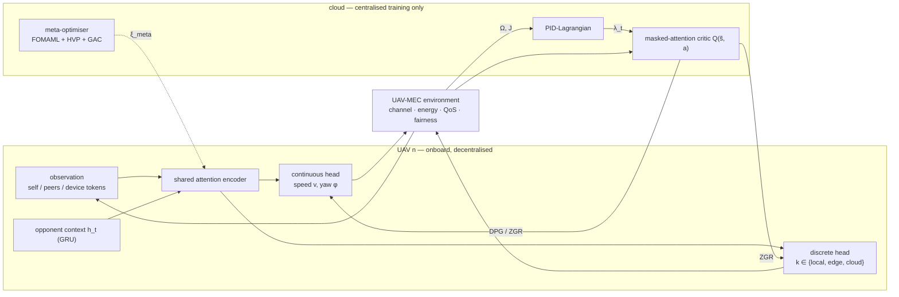

# MAPA-MARL

A compact PyTorch toolkit for **constrained multi-agent reinforcement learning with
hybrid action spaces**, built around a UAV-assisted mobile-edge-computing
simulator: each UAV decides *where to fly* (continuous speed and yaw) and *how to
serve its devices* (categorical: compute locally, at the edge, or relay to the
cloud) while keeping service quality **fair** across devices.

Small enough to read end-to-end, complete enough to run experiments:
~3 k lines, type hints, dataclass configuration, 18 unit tests, CI.

## What is inside

- **Simulator** — probabilistic air-to-ground LoS channel, Shannon uplink rate,
  velocity-dependent propulsion energy, exponential QoS and Jain's fairness index;
  device association, per-UAV compute queues and a task-burst scenario.
- **Hybrid-action agent** — one attention encoder, two heads: a continuous head
  trained with DPG and a categorical head trained with a variance-reduced
  Gumbel-Rao (ZGR) estimator, each with its own learning rate.
- **Constrained RL** — a PID-Lagrangian multiplier with adaptive-EMA derivative
  damping and integral anti-windup for long-term fairness constraints.
- **Spatial attention** — an inverse-distance soft mask added to the attention
  logits, twice differentiable, truncating distant agents' contribution.
- **Opponent modelling** — a GRU that infers peers' behaviour from observed
  actions and feeds a context vector to the actor.
- **Meta layer** — bi-level meta-learning with a first-order inner loop, HVP
  curvature correction and gradient-alignment control (optional).
- **PPO reference implementation** — on-policy training with GAE and three
  discrete-action treatments, for comparison and as a reusable baseline.
- **Tooling** — model profiler (parameters, FLOPs, latency), bootstrapped
  confidence intervals, paired tests, resumable runs.

## Install

```bash
python -m pip install -r requirements.txt
pytest -q                                   # 18 tests, CPU, ~10 s
```

## Quick start

```python
from mapa_exp import UAVMECEnv
from mapa_exp.config import Config

cfg = Config.load("quick")
env = UAVMECEnv(cfg.env, seed=0)
obs = env.reset()

while not env.done:
    # any policy: speed in [0, 1], a unit direction, and a mode
    speed, direction, mode = env.heuristic_action("edge")
    obs, info = env.step(speed, direction, mode)
    print(info["delay"], info["qos"], info["jfi"])
```

Two runnable examples:

```bash
python examples/env_demo.py          # simulator API + heuristic policies
python examples/train_demo.py        # ~2 min training + learning curve
```

Train from the CLI, or profile the network:

```bash
python -m mapa_exp.train --profile quick --episodes 100 --seed 0
python scripts/profile_model.py --profile paper      # params, FLOPs, latency
```

Two profiles ship in `mapa_exp/config.py`: `quick` (3 UAVs / 12 devices /
100 episodes, minutes) and `paper` (5 UAVs / 50 devices / 1200 episodes).

## Design



The critic is only used during centralised training; at inference time a UAV runs
the actor plus the GRU (~4.4 M parameters, ~17 MB in FP32).

## Variants

Everything is a flag on the same code path (`mapa_exp/baselines.py`):

| variant | what it is |
|---|---|
| `mapa_marl` | full agent |
| `w_o_zgr` | categorical head trained with straight-through Gumbel-Softmax |
| `w_o_mask` | dense attention (no spatial prior) |
| `w_o_pid` | plain dual ascent instead of the PID-Lagrangian |
| `maddpg` / `maac` | off-policy baselines without the mask / constraint / RNN |
| `mrltl` | first-order meta-RL (no curvature term) |
| `mappo_native` / `mappo_clipped` / `mappo_stgs` | on-policy PPO baselines |

```python
from mapa_exp.baselines import build_config, make_agent

cfg = build_config("w_o_mask", "quick")
agent = make_agent("w_o_mask", cfg, device="cpu", seed=0)
```

## GPU / CUDA

Everything is device-agnostic (`--device cuda|cpu`), and `mapa_exp/cuda.py` adds
the pieces that make GPU work measurable rather than aspirational: device
resolution and info, FP16 autocast for inference, an optional `torch.compile`
path with a safe fallback, and timing/memory helpers built on warm-up,
`torch.cuda.synchronize()` and p50/p95 percentiles.

```bash
python scripts/benchmark.py --profile paper --batch-sizes 1 8 32 --compile
```

Measured on one RTX 3060, quick profile (3 UAVs, `d_model=64`):

| batch | FP32 p50 | FP16 p50 | decisions/s |
|---|---|---|---|
| 1 | 3.33 ms | 4.74 ms | 301 |
| 8 | 3.28 ms | 4.78 ms | 2 434 |

Two things the measurement makes visible: latency is **flat up to batch 8**, so
the step is launch-bound and batching — not a faster kernel — is what raises
throughput; and FP16 is *slower* at this size, because the extra casts cost more
than the arithmetic they save. Training stays in FP32 on purpose
(deterministic-policy updates are sensitive to half-precision critic gradients);
autocast is offered for the inference path and for measurement.


## Performance

Two transfer optimisations in the inference path, measured with
`scripts/benchmark.py` (RTX 3060, quick profile, batch 1):

| step | decision latency (p50) | throughput |
|---|---|---|
| baseline | 5.57 ms | 180 decisions/s |
| one packed host→device copy for the 10 observation fields | 5.20 ms | 192 decisions/s |
| one packed device→host copy for the whole action | **4.92 ms** | **203 decisions/s** |

The remaining ~4.9 ms is dominated by Python and kernel-launch overhead rather
than arithmetic: the actor forward alone is 3.2 ms, so the interesting lever is
batching agents, not a faster kernel.

## Project layout

```
mapa_exp/
  config.py       # dataclass configs, quick/paper profiles
  env.py          # UAV-MEC simulator
  networks.py     # dual-head actor, masked critic, V(s) critic, opponent GRU
  estimators.py   # ZGR proxy, ST-GS and native categorical estimators
  lagrangian.py   # adaptive EMA-filtered PID-Lagrangian
  agent.py        # rollout + off-policy update
  mappo.py        # on-policy PPO baseline (GAE, clipped surrogate)
  baselines.py    # variant registry and factory
  meta.py         # bi-level meta-learning with GAC
  experiments.py  # resumable runs, greedy roll-outs, seed aggregation
  metrics.py      # bootstrapped CI, convergence episodes, paired tests
  replay.py       # episode buffer + TBPTT window sampling
  cuda.py         # device resolution, autocast, compile, timing, memory
  train.py        # CLI
examples/         # runnable demos
scripts/          # model profiler + benchmark
tests/            # 18 unit tests
docs/             # API reference
```

## Documentation

- [`docs/api.md`](docs/api.md) — configuration, simulator, agents, building blocks, variants and CLI.
- `examples/` — two runnable scripts (simulator walkthrough, training demo).

## Relationship to the paper

The simulator and the agent implement the model of

> *Meta-Policy-Based Multi-Agent Reinforcement Learning for Dynamic UAV Networks:
> Resolving Hybrid Action Spaces and Non-Stationarity*,
> Z. Dai, H. Xie, S. Wei, C. Hu — IEEE Transactions on Vehicular Technology, 2026,
> DOI [10.1109/TVT.2026.3700721](https://doi.org/10.1109/TVT.2026.3700721).

This repository is a **reference implementation of the method and the simulator**,
meant to be read, reused and extended. Physical constants that the paper does not
tabulate are set in `mapa_exp/config.py` with a note on their provenance.

## License

MIT — see [LICENSE](LICENSE).
